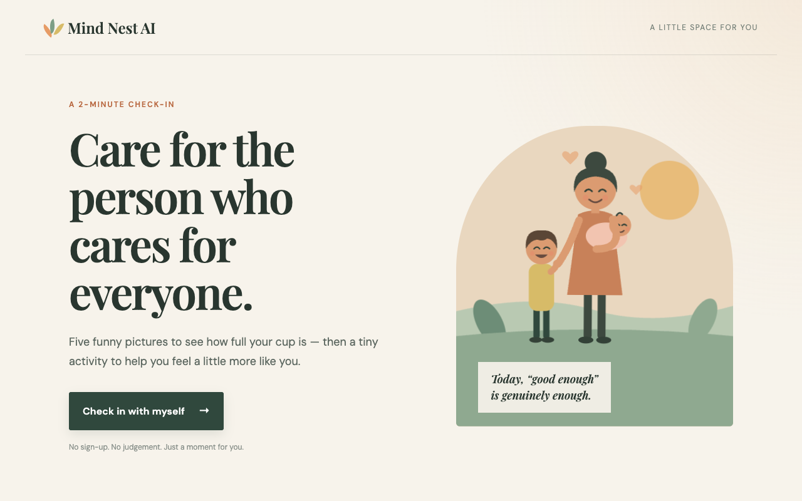
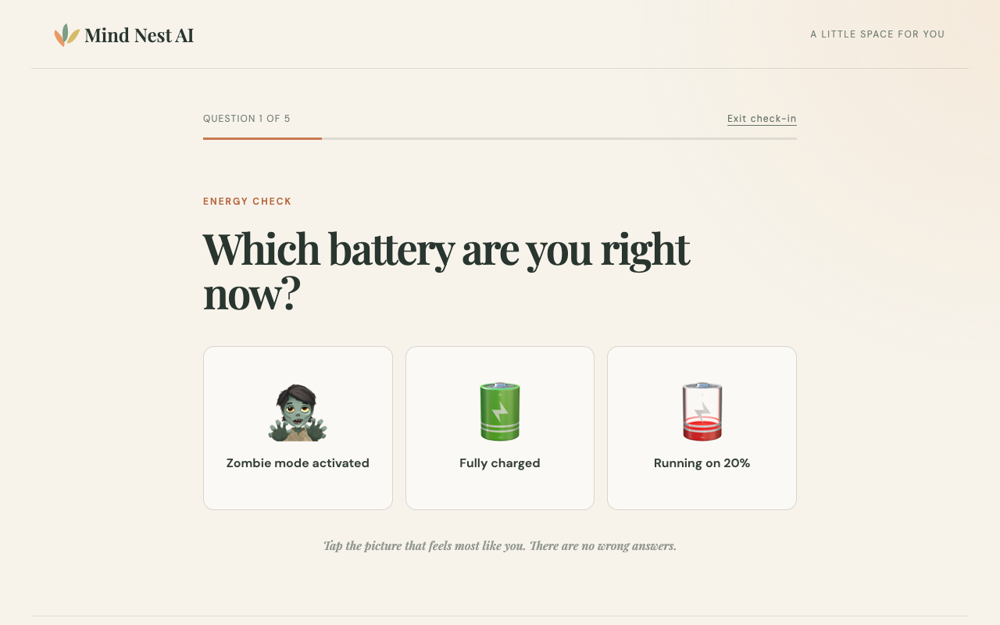
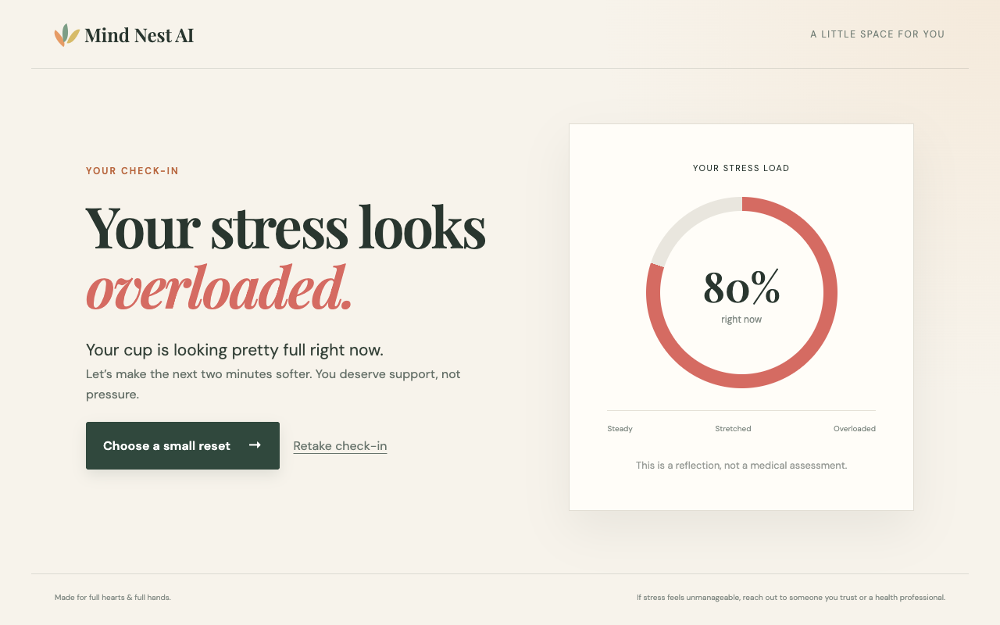
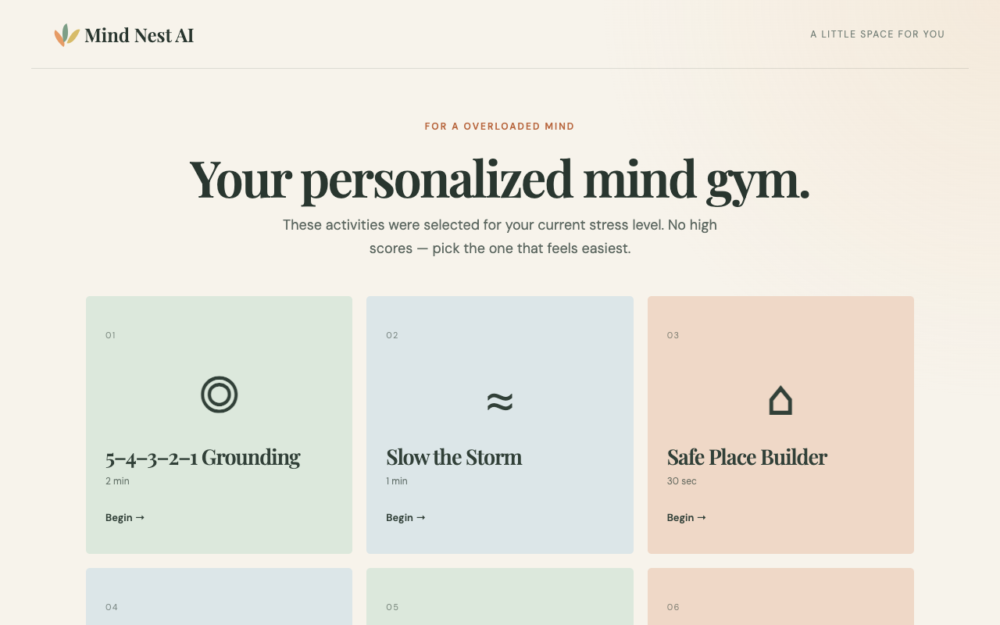
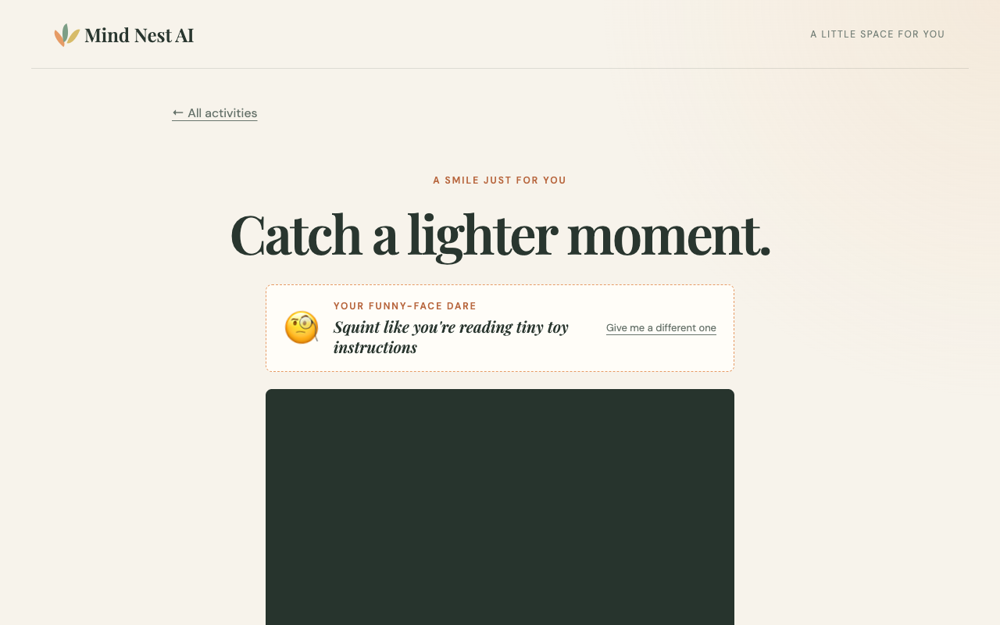
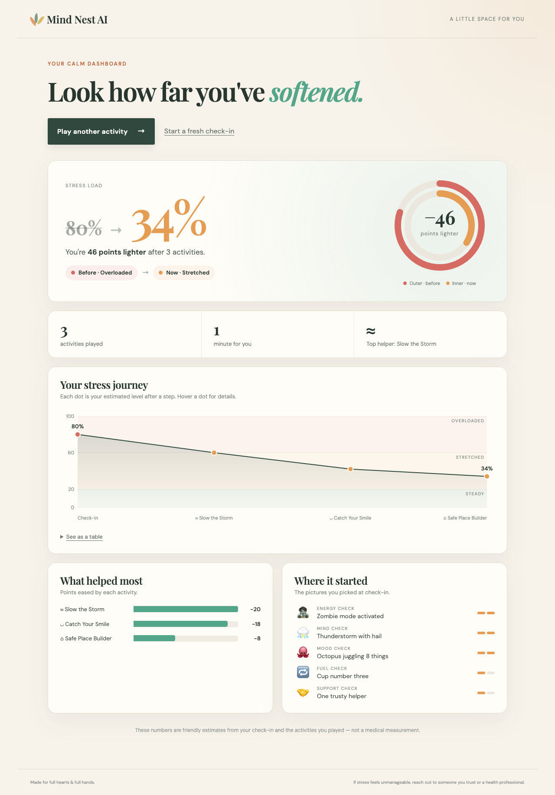
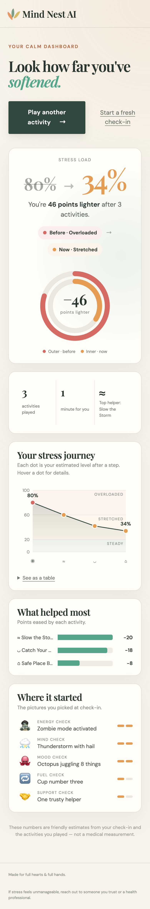

# Mind Nest AI

**A two-minute stress check-in for parents and caregivers — with funny pictures, tiny calming activities, and a dashboard that shows how much lighter you feel.**

👉 **Try it live:** https://manojkicha.github.io/mind_nest/

No sign-up. No judgement. Nothing is uploaded — everything stays in your browser.



---

## How it works

1. **Check in with five funny pictures** — pick the battery, weather, animal, coffee and support picture that feels most like you right now.
2. **See your stress load** — Steady, Stretched or Overloaded, with a simple percentage.
3. **Pick a small reset** — activities matched to your level, plus a few playful extras.
4. **Watch your stress drop** — the calm dashboard tracks your level before and after every activity.

## Screenshots

### 1. Picture check-in
Tap the picture that feels most like you. Picture order is shuffled on every check-in, and each answer quietly counts toward your stress score.



### 2. Your stress level


### 3. Your personalized mind gym
Three activities chosen for your level, plus Catch Your Smile, Gentle Snake and Quiet Tic-Tac-Toe.



### 4. Catch Your Smile — funny-face dare
Get a silly dare (hamster cheeks, suspicious detective, silent lion roar…), turn on your camera, and a 3-2-1 countdown snaps the photo. Save it if you like — it never leaves your device.



### 5. Calm dashboard
After each activity, tap **"I'm done"** to see:
- your stress **before → now**, with twin animated rings
- your **stress journey** across the session (hover a dot for details, or view it as a table)
- **what helped most**, ranked by points eased
- the pictures you picked at check-in

<p>
  
  &nbsp;
  
</p>

> The stress numbers are friendly estimates based on your check-in and the activities you play. Mind Nest AI is a reflection tool, not a medical assessment. If stress feels unmanageable, please reach out to someone you trust or a health professional.

## Activities

| Activity | What it is |
|---|---|
| Breathing (Box Breathing / Slow the Storm / Balance the Mind) | Guided breathing that changes with your stress level |
| Tap (Close the Mind Tabs / 5–4–3–2–1 Grounding / Gratitude Constellation) | Tap eight bubbles: close mental tabs, notice things around you, or light gratitude stars |
| Pause (Thought Parking Lot / Safe Place Builder / Memory Meadow) | A short guided visualization: park a thought, picture a safe place, or save a good memory |
| Catch Your Smile | Funny-face dare + countdown selfie |
| Gentle Snake | A relaxed take on the classic snake game |
| Quiet Tic-Tac-Toe | A no-pressure game, no score kept |

## Built with

- [React 19](https://react.dev/) + TypeScript
- [Vite](https://vite.dev/)
- [Tailwind CSS v4](https://tailwindcss.com/) and hand-written CSS
- Hand-drawn SVG illustration and charts, with no chart library
- Designed in [Figma Make](https://www.figma.com/make/)

## Run it locally

You need Node.js 22 and [pnpm](https://pnpm.io/).

```bash
pnpm install
pnpm dev        # start the dev server
pnpm build      # production build into dist/
```

## Deployment

Every push to `main` builds the app and deploys it to GitHub Pages using the workflow in [`.github/workflows/deploy.yml`](.github/workflows/deploy.yml).

## Privacy

- No accounts and no tracking.
- Camera photos are taken and shown only in your browser. They are never uploaded or stored by Mind Nest AI.
